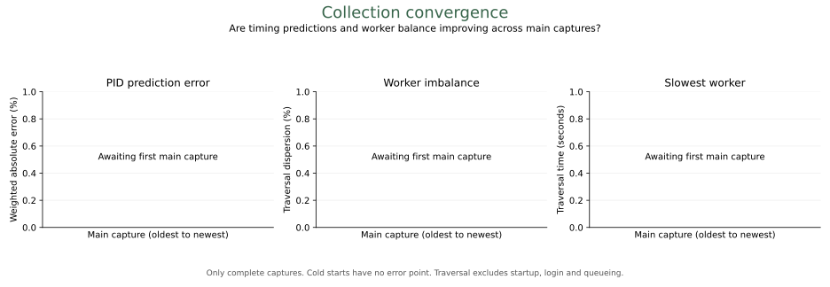

<!-- Generated by resumeme. Edit readme in resumeme.config.yaml; mode: project preserves a custom README. -->

# Emma Doyle - Résumé

My résumé, kept current from LinkedIn and published here as a PDF\. Open the full document for every page and clickable links\.

**[View résumé (PDF - 6 pages)](./../resume.pdf)** - [LinkedIn](https://www.linkedin.com/in/emmeowzing/) - [GitHub](https://github.com/emmeowzing) - [Releases & signatures](https://github.com/astrivant/resumeme/releases)

*Preview of page 1. Click to open the complete PDF.*

<!-- resumeme:convergence:start -->

Measured on complete main captures; lower error means more accurate timing predictions. Cold starts have no prediction error point. Click the plot for its source and run evidence.

<!-- resumeme:convergence:end -->

Built with [resumeme](https://github.com/astrivant/resumeme). [Configuration](../resumeme.config.yaml) - [Automation](automation.md).
